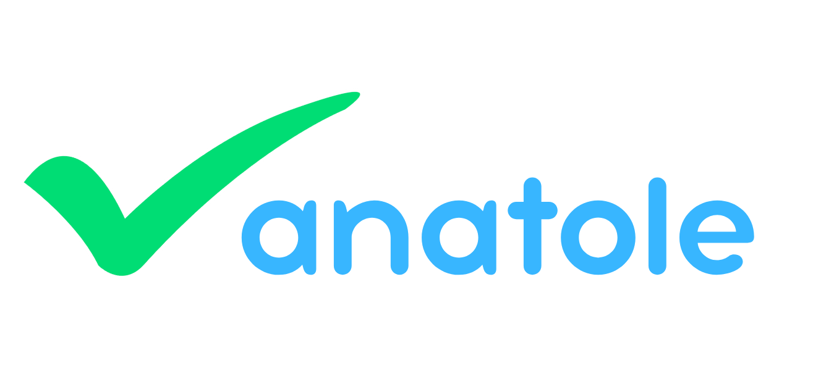

 [](https://creativecommons.org/licenses/by-nc-sa/4.0/)

# 🛡️ Extension Anatole — Vérification des sites administratifs

Cette extension de navigateur a pour objectif de protéger les utilisateurs contre les sites non officiels qui proposent des démarches administratives (passeport, carte d'identité, carte grise, acte de naissance) en facturant des frais injustifiés.

## 🌿 Structure du dépôt

- La branche main contient uniquement le README, la licence et le logo.

- Chaque version de l'extension possède deux branches : une version publiée et une version test.

| Navigateur | Version publiée | Version test |
|------------|-----------------|--------------|
| Chrome     | `chrome`        | `chrome-test` |
| Firefox    | `firefox`       | `firefox-test` |
| Edge       | `edge`          | `edge-test` |

- D'autres branches, communes à toutes les versions, servent au développement de features particulières.

## 🎯 Fonctionnalité principale

Lorsqu'un utilisateur effectue une recherche Google liée à une démarche administrative, l'extension affiche une **bulle d'information** au survol des liens présents dans les résultats :

- ✅ Si le lien mène vers un site officiel (ex. `ants.gouv.fr`, `service-public.fr`), la bulle indique que le site est reconnu et prend la couleur verte.
- ⚠️ Si le lien mène vers un site non officiel, la bulle avertit l'utilisateur du risque de frais supplémentaires et prend la couleur jaune.
- Une page de présentation s'affiche lors de la première installation. Une page annonçant les modifications (changelog) s'affiche lors des mises à jour.

## 🔍 Détection intelligente

- Activation uniquement sur les pages de recherche Google contenant des mots-clés comme :
  - "passeport",
  - "carte identité",
  - "carte d'identité",
  - "carte grise",
  - "acte de naissance",
  - "permis de conduire",
  - "immatriculation",
  - "ANTS"
- Filtrage des liens internes à Google (images, actualités, pagination, etc.) et informatifs (ex. Wikipedia).

## 🧠 Technologies utilisées

- JavaScript (vanilla)
- API DOM pour l'injection dynamique
- Manifest V3 pour Google Chrome et Microsoft Edge, Manifest V2 pour Mozilla Firefox

## 📦 Installation manuelle

1. Cloner la branche correspondante à votre navigateur (ou télécharger ses fichiers depuis GitHub), par exemple pour Chrome :
   ```bash
   git clone -b chrome https://github.com/samsamlh44/anatole.git
   ```
   Remplacer `chrome` par `firefox` ou `edge` selon votre navigateur.

2. Charger l'extension :

   **Chrome**
   - Ouvrir `chrome://extensions/`
   - Activer le **mode développeur**
   - Cliquer sur **« Charger l'extension non empaquetée »** et sélectionner le dossier du projet

   **Edge**
   - Ouvrir `edge://extensions/`
   - Activer le **mode développeur**
   - Cliquer sur **« Charger l'extension décompressée »** et sélectionner le dossier du projet

   **Firefox**
   - Ouvrir `about:debugging#/runtime/this-firefox`
   - Cliquer sur **« Charger un module complémentaire temporaire »**
   - Sélectionner le fichier `manifest.json` du dossier du projet

3. L'extension est maintenant active.

## 🛠️ Personnalisation

- La liste des sites officiels est définie dans `trustedDomains` (dans `content.js`).
- Les mots-clés de recherche sont définis dans `keywords`.

## 📌 À venir

- Fonctionnement de l'extension sur d'autres moteurs de recherche : Bing, Yahoo, DuckDuckGo
- Mises à jour des mots-clés et domaines de confiance

## Licence

> Ce projet est publié sous la licence Creative Commons BY-NC-SA 4.0.  
Le texte juridique officiel, en anglais, est disponible [ici](https://creativecommons.org/licenses/by-nc-sa/4.0/legalcode).\
La [traduction française](https://creativecommons.org/licenses/by-nc-sa/4.0/deed.fr) est fournie à titre informatif.

**<u>Vous êtes autorisé à :</u>**
- **Partager** — copier, distribuer et communiquer le matériel par tous moyens et sous tous formats
- **Adapter** — remixer, transformer et créer à partir du matériel

_L'Offrant ne peut retirer les autorisations concédées par la licence tant que vous appliquez les termes de cette licence._

**<u>Selon les conditions suivantes :**</u>
- **Attribution** — Vous devez créditer l'Œuvre, intégrer un lien vers la licence et indiquer si des modifications ont été effectuées à l'Oeuvre. Vous devez indiquer ces informations par tous les moyens raisonnables, sans toutefois suggérer que l'Offrant vous soutient ou soutient la façon dont vous avez utilisé son Oeuvre.
- **Pas d’utilisation commerciale** — Vous n'êtes pas autorisé à faire un usage commercial de cette Oeuvre, tout ou partie du matériel la composant.
- **Partage dans les mêmes conditions** — Dans le cas où vous effectuez un remix, que vous transformez, ou créez à partir du matériel composant l'Oeuvre originale, vous devez diffuser l'Oeuvre modifiée dans les même conditions, c'est à dire avec la même licence avec laquelle l'Oeuvre originale a été diffusée.
- **Pas de restrictions complémentaires** — Vous n'êtes pas autorisé à appliquer des conditions légales ou des mesures techniques qui restreindraient légalement autrui à utiliser l'Oeuvre dans les conditions décrites par la licence.

_Notes: Vous n'êtes pas dans l'obligation de respecter la licence pour les éléments ou matériel appartenant au domaine public ou dans le cas où l'utilisation que vous souhaitez faire est couverte par une exception._

_Aucune garantie n'est donnée. Il se peut que la licence ne vous donne pas toutes les permissions nécessaires pour votre utilisation. Par exemple, certains droits comme les droits moraux, le droit des données personnelles et le droit à l'image sont susceptibles de limiter votre utilisation._

### Historique de la licence

Ce projet était initialement publié sous licence **GPLv3**.  
Depuis octobre 2025, il est désormais sous licence **Creative Commons BY-NC-SA 4.0**.

Ce changement reflète une volonté de renforcer les **limites d’usage commercial** tout en maintenant l’**accessibilité du code** pour les utilisateurs citoyens.

## 👨‍💻 Auteur

Développé par Samuel BOULLARD.

Ce projet est né d'un constat, celui que les usagers sont confrontés régulièrement à des sites tiers leur facturant des frais supplémentaires lors de leurs démarches administratives en ligne.

[Contact](mailto:contact@samsamdev.fr) | [Site officiel](https://www.anatole-extension.fr)